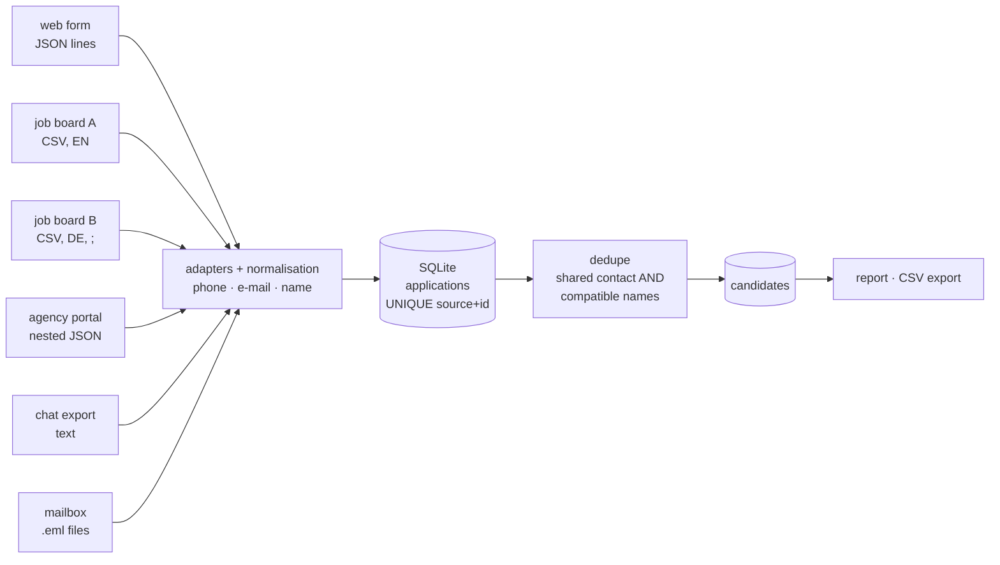

# applicant-inbox-consolidation

[](https://github.com/nikita-automation/applicant-inbox-consolidation/actions/workflows/ci.yml)

Applications arrive through many doors at once: a website form, two job boards, an employment-agency portal,
chat messages, a mailbox. The same person often uses more than one of them — with a different e-mail, a phone
number written three ways, or just a phone number and no name at all.

This project pulls every channel into **one SQLite inbox**, normalises the contact data and merges duplicates
into **one candidate per person** — without gluing strangers together just because they share a phone or a
team mailbox.

Pure Python standard library, no dependencies, no network.

> **Independent demo.** All names, numbers and messages in this repository are fictional (phone numbers use
> the ranges reserved for fiction, e-mail addresses use `example.*`). The code was written from scratch as a
> reference implementation of a generic problem and is not derived from any company's system or data. The
> export formats of the six "channels" are invented for the demo.

## Quick start

```bash
git clone https://github.com/nikita-automation/applicant-inbox-consolidation
cd applicant-inbox-consolidation
PYTHONPATH=src python3 -m applicant_inbox --db inbox.db demo
```

Python 3.9+ is enough. On the bundled sample (30 applications, 6 channels):

```
30 applications from 6 sources -> 18 candidates (12 duplicates merged, 1 group(s) need review)

Per source: agency 3, board_a 5, board_b 5, chat 4, mail 3, webform 10

Merged candidates (10):
  C9f7ea921  Anna Beispiel          3 applications via board_a+chat+webform
  C6fb5f283  Ben Muster             2 applications via board_a+webform
  ...
  Cbfc3188b  Ida Muster             3 applications via agency+chat+webform  [REVIEW]

Needs review - names in this group contradict each other:
  Cbfc3188b  chat:f37215beb524, webform:web-010, agency:AG-79

Possible duplicates - same name, no shared contact (not merged):
  Leon Testmann  -> C9007e9f7, Ccfa2c934
  Kira Probe  -> Cf0957659, C367ec28b

Applications without any usable e-mail or phone (1): chat:68a09460e47f
```

## How the matching works



1. **Adapters** — one small module per channel turns its export into the common `Application` record. A broken
   row is reported with its row/line number and never aborts the import.
2. **Normalisation** — `030 23125 001`, `+49 (0) 30 23125001` and `0049 30 23125001` all become
   `+493023125001`; e-mails are lower-cased; `Müller, Dr. Clara` and `Clara Mueller` get the same name tokens.
   Values that cannot be interpreted become *empty* instead of being guessed. Raw values are kept for audit.
3. **Idempotent ingest** — `(source, source_id)` is unique. Importing the same export twice adds nothing.
4. **Dedupe** — two applications are linked if they share a normalised e-mail **or** phone **and** their names
   do not contradict each other; links are joined transitively. Candidates are derived data, rebuilt from
   scratch on every merge, so the result never depends on import order.

### The traps the sample data contains on purpose

| Situation | What happens |
|---|---|
| Same person, different e-mails, same phone (`web-002`, `A-1005`) | merged |
| `Clara Mueller` vs `Clara Müller`, `BEISPIELMANN, Hasan` vs `Hasan Beispielmann` | merged (names are normalised) |
| Double form submit three minutes apart | merged |
| Chat message with only a phone number, mail with the number in the signature | merged via phone |
| **Two different people share one phone** (`Felix Fiktiv`, `Franka Fiktiv`) | **not merged** — names contradict |
| **Two applicants arrive through the same agency mailbox** (`bewerbung@…`) | **not merged** |
| A nameless chat message from a number shared by two people (`Ida Muster`, `Jan Muster`) | the group is formed but flagged **needs review** |
| Same full name, different contacts, no overlap (`Leon Testmann` ×2) | **not merged**, listed under *possible duplicates* |
| Phone is `n/a` | raw value kept, normalised value empty, application still counted |

A name alone is not an identity, and a shared contact is not proof of identity either; the tool merges only on
the *combination* and tells a human about everything in between.

## Commands

```bash
python -m applicant_inbox --db inbox.db ingest webform data/sample/webform.jsonl   # one channel
python -m applicant_inbox --db inbox.db ingest-dir data/sample                     # all channels (+ merge)
python -m applicant_inbox --db inbox.db merge                                      # rebuild candidates
python -m applicant_inbox --db inbox.db report
python -m applicant_inbox --db inbox.db export --out candidates.csv
```

(prefix each command with `PYTHONPATH=src`). Channels: `webform`, `board_a`, `board_b`, `agency`, `chat`, `mail`.

### Adding a channel

Write `parse(path) -> ParseResult` that builds records with `Application.build(source, source_id, received_at,
name, email, phone, message)` (it normalises for you), then register it in `adapters/__init__.py`. Pick a
`source_id` that is stable across re-exports — the channel's own id, a `Message-ID`, or a hash of the content.
See [docs/DESIGN.md](docs/DESIGN.md) for the reasoning behind the matching rules and their known limits.

## Tests

```bash
PYTHONPATH=src python3 -m unittest discover -s tests
```

43 tests: normalisation tables, every adapter against its sample plus broken-input handling, the full clustering
result (golden), shared-contact and bridge cases, order-independence (25 random shuffles), idempotent re-import
and the CLI. The suite was mutation-checked: flipping individual comparisons in the normaliser, the matcher and
the store makes tests fail. CI runs everything on Python 3.9 and 3.12 and the demo pipeline end to end.

## Limitations

- Matching is deterministic and rule-based. It will not catch a person who used a different e-mail, phone *and*
  spelling — that needs a human, which is why `possible duplicates` exists.
- Transitive links can chain: a nameless message from a shared number bridges two people. Such groups are
  flagged `needs_review`, not split automatically.
- Phone parsing assumes German national format (`+49`) by default; foreign numbers work when written with `+`/`00`.
- The dedupe step is pairwise inside each shared-contact bucket (fine for thousands of applications; a blocking
  index would be the next step for millions).
- Naive timestamps are read as `Europe/Berlin` local time and stored as UTC.

## License

MIT — see [LICENSE](LICENSE).
